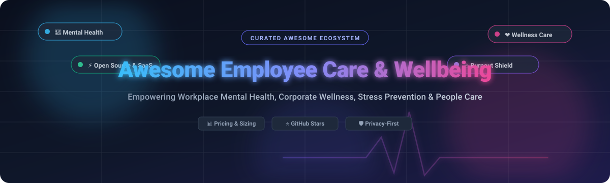

  

# 🌟 Awesome Employee Care & Wellbeing

> 🧘 A curated index of top **SaaS platforms** and **open-source projects** dedicated to workplace mental health, employee wellness programs, burnout reduction, and corporate healthcare benefits.

  
  
  
  
  
  

---

## 📌 Introduction & Scope

Welcome to **Awesome Employee Care & Wellbeing** — the ultimate guide and directory for human resources (HR) professionals, people operations leaders, developers, and wellness committees looking to invest in mental health support, preventive physical wellness, financial counseling, and burnout prevention. 

Whether you are evaluating enterprise-grade corporate benefits or looking to deploy privacy-preserving, self-hosted open-source monitoring systems, this list curates the category leaders, comprehensive market data, pricing structures, and developer datasets.

---

## 📑 Table of Contents

- [📈 Sector Overview & Market Dynamics](#-sector-overview--market-dynamics)
- [☁️ SaaS / Hosted Platforms](#️-saas--hosted-platforms)
- [💻 Open-Source GitHub Projects](#-open-source-github-projects)
- [🤝 How to Contribute](#-how-to-contribute)
- [💖 Support](#-support)
- [⭐ Star History](#-star-history)
- [⚖️ Disclaimer](#️-disclaimer)

---

## 📈 Sector Overview & Market Dynamics

The global corporate wellness and employee care market is valued between **$55 billion and $62 billion**, with forecasts projecting it will surpass **$85 billion by 2030** (~6–8% CAGR), propelled by post-pandemic remote-work models, workplace mental health regulations, and escalating burnout costs.

The industry ecosystem is **moderately to highly fragmented**:
- **Enterprise Giants & Benefits Aggregators** (such as *Personify Health / Virgin Pulse*, *Wellhub / Gympass*, and *Lyra Health*) capture large enterprise health plans through bundled packages.
- **Niche & Regional Innovators** thrive across clinical therapy, mindfulness, asynchronous burnout analysis, sleep health, and bespoke team engagement challenges, preventing any single player from commanding a winner-take-all monopoly.

---

## ☁️ SaaS / Hosted Platforms

Below is an overview of top hosted employee care platforms, sorted in descending order by **company size (market cap / valuation / revenue)**.

| 🏢 Company / Product | 📊 Size (Revenue / Valuation) | 💵 Pricing | 🎁 Free Tier / Trial Limit | 🎯 Key Focus & Overview |
| :--- | :--- | :--- | :--- | :--- |
| **[Salesforce CAREforce](https://www.salesforce.com/news/stories/ten-years-of-careforce/)** | $38.3B Revenue (FY25) / ~$300B Market Cap | Included in enterprise employee benefit packages; internal program model shared via Trailhead & Safety Cloud starting at $25/user/month | No stand-alone SaaS free plan; offers a 30-day free trial of Salesforce Platform with full basic features | Global corporate health, safety, and wellbeing program turning 10 in 2026. Built on four pillars: Communicate, Assist, Respond, and Educate. Over 700 trainings reached 27,000+ employees with 97% safety satisfaction. |
| **[Lyra Health](https://www.lyrahealth.com/)** | $5.58B Valuation (Series F) / ~$1B+ Revenue | Starts at ~$4.00 – $7.00 per employee per month (PEPM) based on contracted employer size | 14-day employer pilot demo available upon request; no permanent free tier | Leading workforce mental health benefits provider covering 17M+ global members. Features AI-driven provider matching, up to 12 employer-sponsored therapy sessions, and 24/7 clinical triage. |
| **[Spring Health](https://www.springhealth.com/)** | $3.3B Valuation (Series E) / ~$500M+ Revenue | Starts at ~$5.00 – $8.00 per employee per month (PEPM) under standard employer enterprise contracts | No perpetual free plan; 14-day guided sandbox access for HR leadership upon request | Precision mental healthcare utilizing machine learning assessments to match employees to custom care pathways. Backed by $190M+ funding with validated clinical ROI. |
| **[Gympass (Wellhub)](https://www.wellhub.com/)** | $2.4B Valuation (Series F) / ~$300M+ Revenue | Starts at $5.00 – $25.00 per employee per month corporate access fee (subsidized employee membership passes tiered from $9.99/mo) | 7-day free trial on standard employee starter plans; no permanent free employer access tier | Global corporate wellness network giving employees unified access to fitness centers, boutique gyms, virtual personal trainers, and digital health apps. |
| **[Calm for Business](https://www.calm.com/business)** | $2.0B Valuation / ~$150M+ Revenue | Starts at $69.99 per seat per year (~$5.83/user/month) with a minimum 10-seat commitment | 14-day free trial for individuals/teams up to 10 users with full content library access; no permanent free tier | Enterprise meditation, focus, and sleep solution. Includes celebrity Sleep Stories, Daily Calm mindfulness routines, stress-management exercises, and Calm Health clinical support. |
| **[Modern Health](https://www.modernhealth.com/)** | $1.17B Valuation (Series D) / ~$100M+ Revenue | Starts at ~$4.50 – $6.50 per employee per month (PEPM) tailored by workforce size and care session bundles | 14-day enterprise trial / guided HR preview upon executive consultation; no permanent free tier | Global comprehensive mental wellbeing platform combining certified coaches, licensed therapists, and digital self-paced cognitive exercises. |
| **[Virgin Pulse (Personify Health)](https://www.personifyhealth.com/)** | $3.0B Merger Valuation / ~$500M+ Revenue | Starts at $3.00 – $6.00 per employee per month (PEPM) for enterprise programs (500+ employee threshold) | 30-day limited administrator evaluation environment; no perpetual free plan | Holistic wellbeing and preventive health engagement platform formed from the merger of Virgin Pulse and HealthComp. Integrates wearables, biometric health screenings, and challenges. |
| **[Headspace for Work](https://www.headspace.com/work)** | ~$1.0B Valuation / ~$120M+ Revenue | Starts at $8.00 – $12.00 per employee per year (or $12.99/user/month on self-serve team plans) | 14-day free trial for teams up to 50 users; free tier limited to basic foundational meditations (Basics 1-3) | Globally recognized mindfulness, meditation, and mental conditioning platform. Features targeted workplace audio tracks (pre-meeting calm, focus sprints) with 30–40% average employee adoption. |
| **[Limeade](https://www.limeade.com/)** | $112M Acquisition (WebMD Health Services) / ~$55M Revenue | Starts at ~$2.50 – $4.50 per employee per month (PEPM) with annual contract deployment | No permanent free tier; 14-day platform administrator pilot trial upon qualification | Employee experience and holistic health software focusing on burnout prevention, team inclusion, manager check-ins, and engagement surveys. |
| **[Wellable](https://www.wellable.co/)** | ~$20M Valuation / ~$10M Revenue | Starts at $75.00/month platform base fee + $1.50 – $3.00 per employee per month | 14-day free trial of challenge software and administrator dashboard; no permanent free plan | Modular wellness challenge, team step competitions, lifestyle content, and incentive tracking platform suited for SMB and mid-market organizations. |

---

## 💻 Open-Source GitHub Projects

Explore transparent, self-hosted, and community-driven tools for employee wellbeing, mental health telemetry, and burnout analytics. Sorted in descending order by **GitHub Stars_Count**.

| 📦 Project | ⭐ GitHub_Stars | 🛠️ Key Features & Stack |
| :--- | :--- | :--- |
| **[Synthetic AI Developer Productivity & Burnout Dataset](https://github.com/syncora-ai/Synthetic-AI-Developer-Productivity-Dataset)** |  | High-fidelity synthetic dataset capturing developer productivity metrics, work hours, task velocity, and cognitive burnout markers. Ideal for training privacy-compliant workplace ML models. |
| **[Burnout.io](https://github.com/reignite/burnout.io)** |  | Open knowledge base, screening guides, and assessment tools engineered to identify and prevent work-related exhaustion and occupational burnout. |
| **[Together App](https://github.com/MacPaw/together-app)** |  | Self-hosted emergency wellbeing and safety tracking platform built by MacPaw to monitor employee safety, psychological wellbeing, and location displacement during crises. Features interactive maps and team status pings. |
| **[Mental Health in the Tech Industry](https://github.com/SouravDasPolok/Mental-Health-in-the-Tech-Industry)** |  | Exploratory data analytics, statistical models, and risk factor identification platform evaluating workplace attitudes, treatment access, and mental illness prevalence across tech workers. |
| **[MindSpace](https://github.com/Inkesk-Dozing/MindSpace)** |  | Multi-modal emotional wellness framework built with Python, Flask, and NLTK for temporal sentiment tracking, behavioral pattern detection, and proactive mental health risk assessments. |
| **[WIA Mental-012 Workplace Wellbeing](https://github.com/WIA-Official/wia-standards-public)** |  | Open standard framework for corporate mental health and wellbeing platforms. Defines evidence-based protocols, HIPAA/GDPR compliance guidelines, and multi-language metrics. |
| **[Employee Wellbeing Analysis](https://github.com/muthyambharath2004/employee_wellbeing)** |  | Employee sentiment and workplace wellbeing analysis repository providing data processing pipelines and visual indicators for workforce satisfaction. |
| **[WellMind](https://github.com/nadeerathilakarathna/WellMind)** |  | AI-powered stress monitoring system assessing workplace mental strain using facial micro-expressions and keystroke dynamics, providing actionable wellbeing recommendations. |
| **[Workplace Mental Health & Stress Analytics Dashboard](https://github.com/noorakhtar30/Workplace-Mental-Health-Stress-Analytics-Dashboard)** |  | Power BI and data pipeline reporting system analyzing organizational stress distributions, demographic risk factors, remote work friction, and employer support mechanisms. |
| **[Mental Health Aware](https://github.com/felipeschneider88/mental-health-aware)** |  | Real-time self-evaluation utility giving employees scheduled micro-moments to reflect on mental fatigue and take preventive restorative actions against burnout. |
| **[NerveNudge](https://github.com/Bhavana-34/NerveNudge)** |  | Lightweight micro-burnout prediction system evaluating daily lifestyle inputs, screen fatigue, and workload indicators to nudge users into timely breaks. |
| **[Mood Flow](https://github.com/meardagoat/MoodFlow-Corporate-Wellness)** |  | Corporate wellness tracking platform with anonymous mood feed, manager analytics, private messaging, and GDPR compliance built on Vue 3, TypeScript, and Supabase. |
| **[MindBridge](https://github.com/guopanqi/mindbridge)** |  | Anonymous employee mental health support platform with chat assistance, anonymous plaza, and case console built with Cloudflare Workers and D1 database. |
| **[WorkMate](https://github.com/karlis0099/WorkMate)** |  | Desktop and local web employee wellbeing companion featuring weekly check-ins across 7 psychological wellbeing dimensions, burnout risk alerts, and Slack/Teams webhooks. |
| **[Stress Detection for IT Professionals](https://github.com/suragms/STRESS-DETECTION-FOR-IT-PROFESSIONALS)** |  | Physiological and behavioral AI stress detection system providing real-time alerts, conversational bot support, and lifestyle interventions. |

---

## 🤝 How to Contribute

Contributions make the open-source and HR community thrive! To add or update an entry:

1. 🍴 **Fork the repo**.
2. 🌿 **Create a feature branch** (`git checkout -b feature/add-new-tool`).
3. ✏️ **Edit [`README.md`](README.md)** with clear links, accurate metrics, pricing, and descriptions.
4. 📬 **Submit a Pull Request** explaining the additions.

---

## 💖 Support

Thank you so much for visiting and using **Awesome Employee Care & Wellbeing**! If you find this directory valuable for your organization, research, or development:

- ⭐ **Star this repository** to help others discover it.
- 🍴 **Fork and share** with colleagues, HR teams, and developer communities.
- ☕ **Buy a Coffee / Sponsor**: Consider supporting ongoing curation and maintenance via the [GitHub Sponsors Dashboard](https://github.com/sponsors/ishandutta2007).

---

## 📈 Star History

---

## ⚖️ Disclaimer

- This is an independent **community-curated** list — inclusion does not constitute endorsement or medical advisory.
- Employee wellbeing platforms handling personal health indicators must comply with health privacy standards (GDPR, HIPAA, CCPA, DPDPA).
- Self-hosted open-source software handling mental health records must adhere to rigorous security best practices, secure at-rest encryption, and clinical protocol safeguards.

---

  <b>Built with care for HR leaders, benefits managers, and developers advancing human-centered workplace wellness.</b>

